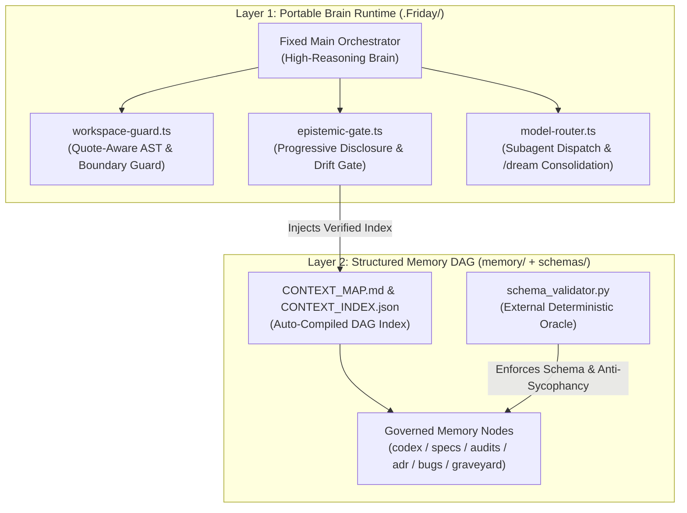

# 💎 pi-prism (`P.R.I.S.M.`)

> **P.R.I.S.M.** — **P**ortable **R**ule-driven **I**ntelligence with **S**tructured **M**emory
>
> *A Domain-Agnostic, Anti-Sycophancy Meta-Harness & Portable Two-Layer Brain Architecture built on top of [`pi-coding-agent`](https://github.com/badlogic/pi-mono).*

---

## 🌟 Why `pi-prism`? (為什麼打造 P.R.I.S.M.？)

像稜鏡（**Prism**）將單一光束折射為清晰的光譜一樣，**`pi-prism`** 將單一、容易產生幻覺與盲從（Sycophancy）的 LLM，轉化為**受規則驅動（Rule-driven）、具備結構化記憶圖譜（Structured Memory）、且跨模型交叉驗證（Dialectical Verification）**的可攜式工程大腦。

傳統 AI Coding Agent 在專案規模擴大、跨越多個對話 Session 後，常陷入三大致命困境：
1. **盲目討好與自我催眠（Sycophancy & Self-Grading）**：同一個模型自己寫 Code、自己審核、自己誇獎自己通過。
2. **脈絡腐敗與記憶失憶（Context Rot & Drift）**：文件越寫越多、新舊規格衝突，Agent 載入過時資訊導致開發到一半邏輯錯亂。
3. **防護脆弱與環境綁定（Fragile Guardrails & Lock-in）**：缺乏確定性的工具鏈攔截，且大腦配置散落於系統全域目錄，無法隨專案版控帶走。

**`pi-prism`** 透過 **「兩層式可攜大腦（`.Friday` Runtime + `memory/` DAG 圖譜）」** 與 **「確定性驗證鐵三角」** 徹底解決上述問題。

---

## 🏛️ Core Architecture (核心架構四大支柱)



### 1. Portable Two-Layer Brain (`P`ortable)
- **Layer 1 — 執行期神經中樞 ([`.Friday/`](.Friday/))**：封裝 Hooks、跨模型 Subagent 定義 ([`.Friday/agents/`](.Friday/agents/))、提示詞契約 ([`.Friday/prompts/`](.Friday/prompts/)) 與技能 ([`.Friday/skills/`](.Friday/skills/))。只需透過 `PI_CODING_AGENT_DIR=$(pwd)/.Friday pi` 即可在任何機器啟動完整大腦。
- **Layer 2 — 結構化記憶層 ([`memory/`](memory/))**：100% 隨 Git 版控的專案長期記憶，與執行期配置乾淨解耦。

### 2. Rule-Driven Guardrails & Anti-Sycophancy (`R`ule-driven `I`ntelligence)
- **反盲從跨模型互審（Anti-Sycophancy Invariant）**：在 `verified` 狀態的記憶與規格節點中，強制要求 **`author.model != reviewer.model`**（例如由不同模型家族分別撰寫與審查），嚴禁同模型自我背書。
- **外部獨立驗證器（[`schemas/schema_validator.py`](schemas/schema_validator.py)）**：LLM 絕不自己給自己打分數。所有 Frontmatter 契約、拓撲完整性、行數預算（Prose Line Budget）與測試預言機（Verification Oracle）皆由外部 Python 腳本決定性裁決。
- **語法感知安全護欄（[`workspace-guard.ts`](.Friday/extensions/workspace-guard.ts)）**：採用雙狀態引號感知剖析器（Quote-Aware Parser），精準攔截越界路徑（`BOUNDARY`）、機密讀取（`SEC-CRED`）、大腦自毀修改（`SEC-BRAIN`）與危險破壞指令（`SEC-CMD-V1`），並回傳具修復指引的 `RemediationPointer`。

### 3. Structured Epistemic Memory & `/dream` (`S`tructured `M`emory)
- **零漂移全文件 Schema 納管**：拒絕無結構的散落文件。所有架構規格、演進路線圖、ADR 與審計紀錄皆納管於 [`memory/`](memory/) 職責目錄，並由 [`scripts/auto_update_map.py`](scripts/auto_update_map.py) 自動編譯出 [`memory/codex/CONTEXT_MAP.md`](memory/codex/CONTEXT_MAP.md) 與 [`memory/index/CONTEXT_INDEX.json`](memory/index/CONTEXT_INDEX.json)（含 DAG 循環依賴與斷鏈偵測）。
- **認知誠實門閥（[`epistemic-gate.ts`](.Friday/extensions/epistemic-gate.ts)）**：強制區分 `[FACT]`（經工具驗證之事實）與 `[INFERRED]`（推論），並在每回合自動進行漸進式揭露（Progressive Disclosure）。
- **`/dream` 睡眠記憶固化（Memory Consolidation）**：將跨 Session 的瑣碎對話去蕪存菁，自動提煉為永久受 Schema 保護的記憶節點。

---

## 📂 Repository Structure (目錄結構)

```text
.
├── AGENTS.md                        # L0 全域精簡憲法 (Always-Loaded Entrypoint, <60 lines)
├── README.md                        # P.R.I.S.M. 專案總覽與快速啟動指南
├── .Friday/                         # [Layer 1] 可攜式 Agent 執行期大腦 (PI_CODING_AGENT_DIR)
│   ├── settings.json                # 啟用之 Extensions、Prompts、Skills 與預設模型配置
│   ├── models.json                  # 多供應商/本地端模型註冊表 (不含任何明文 API Key)
│   ├── agents/                      # 固定職責之專業 Subagents (scout, architect, challenger, worker, auditor)
│   ├── extensions/                  # 三大核心 TypeScript Hooks
│   │   ├── workspace-guard.ts       # 邊界、憑證、大腦保護與 Shell 語法感知攔截器
│   │   ├── epistemic-gate.ts        # 漸進式記憶注入與認知誠實度檢查門閥
│   │   └── model-router.ts          # 動態路由與子代理調度器 (pi-router/auto, /dream, /verify-memory)
│   ├── prompts/                     # 結構化驗證與記憶寫入 Prompt 模板
│   └── skills/                      # 隨附技能包 (memory-librarian, dialectical-verifier)
├── memory/                          # [Layer 2] 100% 受 Schema 納管的零漂移記憶圖譜
│   ├── codex/                       # 000~200: 靈魂憲法、全域鐵律、核心決策與 CONTEXT_MAP.md
│   ├── specs/                       # 200~700: 六階段演進路線圖、模型指南與架構藍圖
│   ├── audits/                      # 600: 跨模型獨立驗證與審計報告
│   └── index/                       # 機器可讀之拓撲與 affected_paths 索引 (CONTEXT_INDEX.json)
├── schemas/
│   └── schema_validator.py          # 外部決定性驗證器 (Schema + DAG + Anti-Sycophancy + Oracle)
└── scripts/
    ├── auto_update_map.py           # DAG 拓撲檢查與 CONTEXT_MAP 自動編譯器
    └── test_friday_architecture.py  # 五合一端到端架構自動化驗證套件
```

---

## 🚀 Quick Start (快速啟動指南)

### 1. 環境需求
- **Python 3.10+**（用於執行外部決定性驗證器與 DAG 索引編譯器）
- **Node.js 20+** 與 [`@mariozechner/pi-coding-agent`](https://github.com/badlogic/pi-mono) CLI（`pi`）
  > 💡 **硬體相容性說明**：本架構之 Hooks、驗證器與子程序調度完全不依賴本地 GPU 或特定 CPU 指令集（在無 `AVX2` 的舊款 CPU 如 Intel i5-3570K 與最新世代硬體上皆可 100% 順暢運作）。

### 2. 設定 API Keys（透過環境變數注入，絕不寫入專案檔案）
請參考受 Schema 納管的完整指南：[`memory/specs/500_MODEL_APIKEY_GUIDE.md`](memory/specs/500_MODEL_APIKEY_GUIDE.md)。
```bash
export ANTHROPIC_API_KEY="sk-ant-..."
export GEMINI_API_KEY="AIzaSy..."
export OPENAI_API_KEY="sk-proj-..."
```

### 3. 執行架構完整性與五合一自動化測試
在啟動 Agent 前，先用外部決定性驗證器確認所有記憶節點、DAG 圖譜與 Hooks 皆處於 100% 健康狀態：
```bash
# 1. 驗證所有記憶節點 Schema、反盲從規則與執行 Verification Oracles
python3 schemas/schema_validator.py --run-oracle

# 2. 重新編譯記憶導覽圖並執行 DAG 循環/斷鏈檢查
python3 scripts/auto_update_map.py

# 3. 執行五合一端到端架構測試套件
python3 scripts/test_friday_architecture.py
```

### 4. 掛載可攜式大腦並啟動 `pi`
在專案根目錄下，將 `PI_CODING_AGENT_DIR` 指向專案內的 `.Friday` 大腦即可啟動：
```bash
PI_CODING_AGENT_DIR=$(pwd)/.Friday pi
```

啟動後可在 `pi` 互動介面中使用內建擴充指令：
- `/route <task>`：分析任務複雜度並推薦最佳專業 Subagent 與跨模型配置。
- `/subagents`：檢視所有受控專業子代理清單與綁定模型。
- `/verify-memory`：一鍵觸發外部 Schema 驗證器與 `CONTEXT_MAP.md` 同步。
- `/dream`：執行跨 Session 睡眠記憶萃取與固化流程。

---

## 🗺️ Governed Blueprints & Evolution Roadmap (核心藍圖與演進路線圖)

本專案實踐 **「Dogfooding（自己吃自己的狗糧）」**——連專案自身的架構藍圖與開發路線圖，都嚴格遵循 Schema 契約存放在 [`memory/specs/`](memory/specs/) 中，由驗證器確保永不與程式碼脫節：

- 📘 **[`memory/specs/700_HARNESS_BLUEPRINT.md`](memory/specs/700_HARNESS_BLUEPRINT.md)** (`MEM-2026-0005`)：完整收錄八大架構設計契約與零漂移治理機制。
- 🔑 **[`memory/specs/500_MODEL_APIKEY_GUIDE.md`](memory/specs/500_MODEL_APIKEY_GUIDE.md)** (`MEM-2026-0006`)：固定主控大腦與多模型 API Key 注入規範。
- 🚀 **[`memory/specs/200_OPTIMIZATION_ROADMAP.md`](memory/specs/200_OPTIMIZATION_ROADMAP.md)** (`MEM-2026-0007`)：從 **V0 Baseline** 邁向全自動化的 **6 階段工程演進路線圖（Stage 1 ~ Stage 6）**。

---

## 📜 License

MIT License
