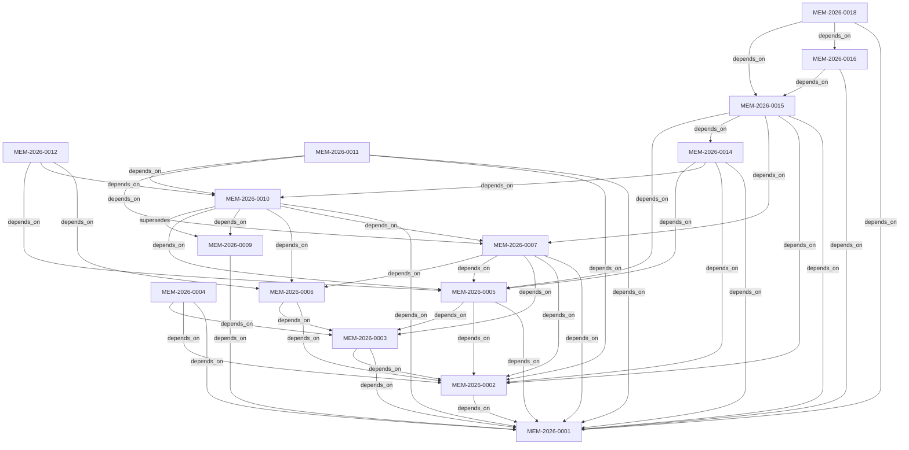

# 🗺️ PotoTypeV0 × Friday Context Registry & Topology Map (CONTEXT_MAP.md)

> **自動生成時間**: `2026-10-31T07:38:18Z` | **Agentic Harness**: `Friday` | **記憶節點總數**: `16`
> **漸進式揭露原則 (Progressive Disclosure)**: Agent 啟動時僅注入活躍節點 (`verified`/`draft`) 之單行摘要，按節點鍵值 (`node_key`) 或節點 ID (`node_id`) 按需調閱對應檔案。

## 1. 領域分層索引表 (Domain Layer Registry 000–900)

### 🧩 `000` — 000 Core Constitution & Soul (核心憲法與靈魂)

| 定位鍵 (`node_key`) | 節點 ID (`node_id`) | 類型 | 狀態 | 產出模型 ➔ 審查模型 | 單行摘要 (`summary_1line`) | 路徑 |
| :--- | :--- | :---: | :---: | :--- | :--- | :--- |
| `000.SOUL.v1` | `MEM-2026-0001` | `constitution` | `verified` | `deepseek-ai/deepseek-v4.1-flash` ➔ `z-ai/glm-5.3` | Friday Agentic Harness 核心憲法：定義四級認知誠實標籤、跨模型對抗審查與獨立驗證斷言 (Oracle) 鐵律。 | [000_SOUL.md](000_SOUL.md) |

### 🧩 `100` — 100 System Architecture & Security Guardrails (系統架構與安全護欄)

| 定位鍵 (`node_key`) | 節點 ID (`node_id`) | 類型 | 狀態 | 產出模型 ➔ 審查模型 | 單行摘要 (`summary_1line`) | 路徑 |
| :--- | :--- | :---: | :---: | :--- | :--- | :--- |
| `100.ARCH-RULES.v1` | `MEM-2026-0002` | `rule` | `verified` | `deepseek-ai/deepseek-v4.1-flash` ➔ `z-ai/glm-5.3` | 定義 Friday Harness 之工作區邊界護欄：鎖定 ctx.cwd、保護 .Friday 大腦核心 (SEC-BRAIN)、隔離金鑰 (SEC-CRED)、根目錄 .md 保護 (SEC-DOC-GOVERNANCE) 與攔截危險指令。 | [100_ARCH_RULES.md](100_ARCH_RULES.md) |

### 🧩 `200` — 200 Optimization Roadmap & Epistemic Governance (優化藍圖與認識論治理)

| 定位鍵 (`node_key`) | 節點 ID (`node_id`) | 類型 | 狀態 | 產出模型 ➔ 審查模型 | 單行摘要 (`summary_1line`) | 路徑 |
| :--- | :--- | :---: | :---: | :--- | :--- | :--- |
| `200.ADR-001.v1` | `MEM-2026-0003` | `adr` | `verified` | `deepseek-ai/deepseek-v4.1-flash` ➔ `z-ai/glm-5.3` | ADR-001：採用 Pi v1.3.0 registerVirtualModel 實作 pi-router/auto 動態路由，並配置 5 角色跨模型子代理協作團隊。 | [200_DECISIONS.md](200_DECISIONS.md) |
| `200.OPT-ROADMAP.v1` | `MEM-2026-0007` | `spec` | `verified` | `deepseek-ai/deepseek-v4.1-flash` ➔ `z-ai/glm-5.3` | PotoTypeV0 × Friday 六階段通用優化、固定主腦調度、防錯亂保險 (AS-05/AS-06/Drift Alert) 與 /dream 夢境記憶整理演進路線圖。 | [200_OPTIMIZATION_ROADMAP.md](../specs/200_OPTIMIZATION_ROADMAP.md) |

### 🧩 `300` — 300 Core Domain Logic & Modules (核心領域邏輯與模組)

| 定位鍵 (`node_key`) | 節點 ID (`node_id`) | 類型 | 狀態 | 產出模型 ➔ 審查模型 | 單行摘要 (`summary_1line`) | 路徑 |
| :--- | :--- | :---: | :---: | :--- | :--- | :--- |
| `300.LIBRARY-WIKI-AND-SEAMLESS-ROUTER.v1` | `MEM-2026-0015` | `spec` | `verified` | `google-vertex/gemini-4-argon` ➔ `nvidia/nemotron-3-ultra-550b-a55b` | 圖書館/公文 Schema 擴充與雙腦絲滑分派總藍圖：確立記憶圖書館與 Wiki 為核心主題、改造無感透明代讀 Router 並定義 AGY Teamwork 分層派工矩陣。 | [640_MODULAR_PLUGIN_AND_HOOK_BLUEPRINT.md](../specs/640_MODULAR_PLUGIN_AND_HOOK_BLUEPRINT.md) |
| `320.EXTENSION-AND-SCHEMA-RECIPES.v1` | `MEM-2026-0018` | `wiki` | `verified` | `claude-opus-4-6-thinking` ➔ `None` | Stage 6 Extension Recipes, Schema Guardrails, Unified /dream, Nemotron Web Research, and Code Intelligence Map | [320_EXTENSION_AND_SCHEMA_RECIPES.md](../wiki/320_EXTENSION_AND_SCHEMA_RECIPES.md) |

### 🧩 `310` — 310 Library Wiki & Knowledge Graph Notes (知識庫 Wiki 與圖譜筆記)

| 定位鍵 (`node_key`) | 節點 ID (`node_id`) | 類型 | 狀態 | 產出模型 ➔ 審查模型 | 單行摘要 (`summary_1line`) | 路徑 |
| :--- | :--- | :---: | :---: | :--- | :--- | :--- |
| `310.WIKI-GRAPH-GUIDE.v1` | `MEM-2026-0016` | `wiki` | `verified` | `flash` ➔ `None` | Friday Library Wiki and Bidirectional Knowledge Graph Guide | [310_WIKI_GRAPH_GUIDE.md](../wiki/310_WIKI_GRAPH_GUIDE.md) |

### 🧩 `500` — 500 Agentic Harness & Prompt Contracts (代理控制軛與提示詞契約)

| 定位鍵 (`node_key`) | 節點 ID (`node_id`) | 類型 | 狀態 | 產出模型 ➔ 審查模型 | 單行摘要 (`summary_1line`) | 路徑 |
| :--- | :--- | :---: | :---: | :--- | :--- | :--- |
| `500.MODEL-APIKEY-SPEC.v1` | `MEM-2026-0006` | `spec` | `verified` | `deepseek-ai/deepseek-v4.1-flash` ➔ `z-ai/glm-5.3` | Friday 模型分配之 4 大設定位置（models.json、settings.json、model-router.ts、agents/*.md）與多組 API Key 分流配置規格。 | [500_MODEL_APIKEY_GUIDE.md](../specs/500_MODEL_APIKEY_GUIDE.md) |
| `510.MODEL-POOL-PLANNING.v1` | `MEM-2026-0012` | `spec` | `verified` | `nvidia/nemotron-3-ultra-550b-a55b` ➔ `deepseek-ai/deepseek-v4.1-flash` | NVIDIA 模型庫強項分配與被動斷路器 (Passive Circuit Breaker) 策略規範，釐清 models.json 與 models-store.json 定位，並定義不干擾 KV Cache 與 40 RPM 配額之健康管理。 | [510.MODEL-POOL-PLANNING.v1.md](../specs/510.MODEL-POOL-PLANNING.v1.md) |
| `500.ROUTER-V2-MULTITURN.v1` | `MEM-2026-0010` | `spec` | `verified` | `google-vertex/gemini-4-argon` ➔ `nvidia/nemotron-3-ultra-550b-a55b` | Router v2 架構重構規格：定義多輪累進專家迴圈、同迴圈 Sticky Key 池 (遇 429 等待 RPM 恢復) 與 Hook 自動化文件同步藍圖。 | [610_ROUTER_V2_REDESIGN.md](../specs/610_ROUTER_V2_REDESIGN.md) |
| `500.PULSE-SCHEDULER.v1` | `MEM-2026-0011` | `spec` | `draft` | `google-vertex/gemini-4-argon` ➔ `deepseek-ai/deepseek-v4.1-flash` | Friday Pulse 智慧背景排程初步藍圖：定義定時/事件/動態心跳三模態觸發、免費 Scout 前哨過濾與收件匣隔離簽核機制。 | [620_FRIDAY_PULSE_SCHEDULER_SPEC.md](../specs/620_FRIDAY_PULSE_SCHEDULER_SPEC.md) |
| `500.HARNESS-DETAX.v1` | `MEM-2026-0014` | `spec` | `verified` | `google-vertex/gemini-4-argon` ➔ `nvidia/nemotron-3-ultra-550b-a55b` | Friday 框架減稅與正交重構規格：消除雙重抽稅、賦予專家唯讀視野、收斂 SEC-DOC-GOVERNANCE 為根目錄保護並重構精簡角色 Prompt。 | [630_HARNESS_DETAX_AND_PROMPT_ORTHOGONALITY.md](../specs/630_HARNESS_DETAX_AND_PROMPT_ORTHOGONALITY.md) |

### 🧩 `600` — 600 Verification Oracles & Testing (驗證神諭與測試基準)

| 定位鍵 (`node_key`) | 節點 ID (`node_id`) | 類型 | 狀態 | 產出模型 ➔ 審查模型 | 單行摘要 (`summary_1line`) | 路徑 |
| :--- | :--- | :---: | :---: | :--- | :--- | :--- |
| `600.AUDIT-001.v1` | `MEM-2026-0004` | `audit` | `deprecated` | `poolside/laguna-xs-2.1` ➔ `z-ai/glm-5.3-flash` | PotoTypeV0 專案與 Friday Agentic Harness 初始化驗收紀錄：記錄四大核心模組之驗收基準與依賴拓撲。 | [MEM-2026-0004_HARNESS_INIT_AUDIT.md](../audits/MEM-2026-0004_HARNESS_INIT_AUDIT.md) |
| `600.AUDIT-002.v1` | `MEM-2026-0009` | `audit` | `deprecated` | `google-vertex/gemini-4-argon` ➔ `nvidia/nemotron-3-ultra-550b-a55b` | WO-2026-R1 (M1~M7) 與 Stage 4~5 壓力測試驗收報告：記錄已通過之防禦機制與待修復之 4 項執行期瓶頸。 | [MEM-2026-0009_ROUTER_STRESS_AUDIT.md](../audits/MEM-2026-0009_ROUTER_STRESS_AUDIT.md) |

### 🧩 `700` — 700 Operations, Telemetry & Runtime (維運、遙測與執行期治理)

| 定位鍵 (`node_key`) | 節點 ID (`node_id`) | 類型 | 狀態 | 產出模型 ➔ 審查模型 | 單行摘要 (`summary_1line`) | 路徑 |
| :--- | :--- | :---: | :---: | :--- | :--- | :--- |
| `700.HARNESS-BLUEPRINT.v1` | `MEM-2026-0005` | `spec` | `verified` | `deepseek-ai/deepseek-v4.1-flash` ➔ `z-ai/glm-5.3` | Friday × PotoTypeV0 雙層可攜式 Agentic Harness 完整架構藍圖、四大生命週期與全文件 Schema 防錯亂機制。 | [700_HARNESS_BLUEPRINT.md](../specs/700_HARNESS_BLUEPRINT.md) |

### 🧩 `900` — 900 Audits, Postmortems & Historical Ledgers (審計、事後檢討與歷史帳本)

| 定位鍵 (`node_key`) | 節點 ID (`node_id`) | 類型 | 狀態 | 產出模型 ➔ 審查模型 | 單行摘要 (`summary_1line`) | 路徑 |
| :--- | :--- | :---: | :---: | :--- | :--- | :--- |
| `900.SESSION_DIGEST.v1` | `MEM-2026-0019` | `digest` | `verified` | `flash` ➔ `None` | Episodic Session Digest Log documentation entry | [SESSION_DIGEST.md](../episodic/SESSION_DIGEST.md) |

## 2. 記憶節點依賴拓撲圖 (Context Dependency DAG)

## 3. 源碼 AST Import 依賴拓撲表 (Python & TypeScript Code Dependency Graph)

| 來源模組 (`from`) | 目標依賴 (`to`) | 依賴類型 (`type`) |
| :--- | :--- | :---: |
| `scripts/auto_update_map.py` | `schemas/schema_validator.py` | `py_from_import` |
| `scripts/sync_doc_metadata.py` | `schemas/schema_validator.py` | `py_import` |
| `scripts/test_friday_architecture.py` | `scripts/auto_update_map.py` | `py_from_import` |
| `scripts/test_friday_architecture.py` | `scripts/sync_doc_metadata.py` | `py_from_import` |
| `scripts/test_friday_architecture.py` | `schemas/schema_validator.py` | `py_import` |
| `.Friday/extensions/epistemic-gate.ts` | `@earendil-works/pi-coding-agent` | `ts_sdk_import` |
| `.Friday/extensions/model-router.ts` | `@earendil-works/pi-ai` | `ts_sdk_import` |
| `.Friday/extensions/model-router.ts` | `@earendil-works/pi-coding-agent` | `ts_sdk_import` |
| `.Friday/extensions/subagent/agents.ts` | `@earendil-works/pi-coding-agent` | `ts_sdk_import` |
| `.Friday/extensions/subagent/index.ts` | `@earendil-works/pi-agent-core` | `ts_sdk_import` |
| `.Friday/extensions/subagent/index.ts` | `@earendil-works/pi-ai` | `ts_sdk_import` |
| `.Friday/extensions/subagent/index.ts` | `@earendil-works/pi-coding-agent` | `ts_sdk_import` |
| `.Friday/extensions/subagent/index.ts` | `@earendil-works/pi-tui` | `ts_sdk_import` |
| `.Friday/extensions/subagent/index.ts` | `.Friday/extensions/subagent/agents.ts` | `ts_local_import` |
| `.Friday/extensions/workspace-guard.ts` | `@earendil-works/pi-coding-agent` | `ts_sdk_import` |

### 3.2 源碼符號、Hook 註冊與規格影響圈總表 (Code Intelligence & Impact Map)

| 源碼路徑 (`file_path`) | 主要符號與行號 (`symbols`) | Pi 擴充註冊 (`command`/`tool`/`hook`) | 影響圈 (`imported_by`) | 綁定規格 (`governing_specs`) |
| :--- | :--- | :--- | :--- | :--- |
| `.Friday/extensions/epistemic-gate.ts` | `CATALOG_STAGE2_THRESHOLD`(L19-L19), `buildProgressiveContextSummary`(L21-L21), `findAffectedMemoryNodes`(L108-L108), `getSessionPinnedContextSummary`(L153-L153), `clearSessionPinnedContextSummaries`(L164-L164), `FridayEpistemicBridge`(L168-L168) | `tool:query_library`(L318), `hook:session_shutdown`(L340), `hook:session_start`(L392), `hook:before_agent_start`(L397), `hook:tool_result`(L412) | — | `200.OPT-ROADMAP.v1`, `500.ROUTER-V2-MULTITURN.v1`, `500.HARNESS-DETAX.v1`, `300.LIBRARY-WIKI-AND-SEAMLESS-ROUTER.v1`, `700.HARNESS-BLUEPRINT.v1`, `320.EXTENSION-AND-SCHEMA-RECIPES.v1` |
| `.Friday/extensions/model-router.ts` | `FridayEpistemicBridge`(L33-L33), `DEFAULT_ROLE_MODELS`(L80-L80), `RoleName`(L90-L90), `SpecialistRole`(L91-L91), `StrategyMode`(L92-L92), `ROLE_FALLBACK_CHAINS`(L95-L95) | `hook:session_start`(L1069), `hook:session_shutdown`(L1074), `hook:turn_start`(L1146), `hook:before_agent_start`(L1150), `hook:tool_call`(L1270), `tool:dispatch_specialist`(L1394) | — | `600.AUDIT-002.v1`, `200.OPT-ROADMAP.v1`, `500.MODEL-APIKEY-SPEC.v1`, `510.MODEL-POOL-PLANNING.v1`, `500.ROUTER-V2-MULTITURN.v1`, `500.PULSE-SCHEDULER.v1`, `500.HARNESS-DETAX.v1`, `300.LIBRARY-WIKI-AND-SEAMLESS-ROUTER.v1`, `700.HARNESS-BLUEPRINT.v1` |
| `.Friday/extensions/subagent/agents.ts` | `AgentScope`(L9-L9), `AgentConfig`(L11-L11), `AgentDiscoveryResult`(L21-L21), `discoverAgents`(L128-L128), `formatAgentList`(L149-L149) | — | `.Friday/extensions/subagent/index.ts` | — |
| `.Friday/extensions/subagent/index.ts` | — | `tool:subagent`(L549) | — | `500.ROUTER-V2-MULTITURN.v1`, `300.LIBRARY-WIKI-AND-SEAMLESS-ROUTER.v1`, `700.HARNESS-BLUEPRINT.v1` |
| `.Friday/extensions/web-research.ts` | `OutboundCheckResult`(L5-L5), `WebPageSnippet`(L10-L10), `NemotronGuardVerdict`(L17-L17), `IPI_DETERMINISTIC_RE`(L32-L32), `validateOutboundSafety`(L35-L35), `loadNvidiaApiKeys`(L74-L74) | `tool:web_research`(L513) | — | `320.EXTENSION-AND-SCHEMA-RECIPES.v1` |
| `.Friday/extensions/workspace-guard.ts` | `formatRemediation`(L110-L110), `parseShellCommandQuoteAware`(L122-L122), `isReadOnlyBashCommand`(L248-L248), `checkPortabilityViolation`(L315-L315), `extractPathsFromBash`(L365-L365) | `hook:session_start`(L558), `hook:user_bash`(L564), `hook:tool_call`(L588), `command:/guard`(L724) | — | `200.OPT-ROADMAP.v1`, `500.PULSE-SCHEDULER.v1`, `500.HARNESS-DETAX.v1`, `300.LIBRARY-WIKI-AND-SEAMLESS-ROUTER.v1`, `700.HARNESS-BLUEPRINT.v1` |
| `schemas/schema_validator.py` | `parse_markdown_frontmatter`(L71-L86), `count_prose_lines`(L89-L115), `check_as05_portability`(L118-L127), `load_all_memory_nodes`(L130-L144), `check_as06_node_exclusivity`(L147-L186), `detect_unlinked_topology_references`(L189-L235) | — | `scripts/auto_update_map.py`, `scripts/sync_doc_metadata.py`, `scripts/test_friday_architecture.py` | `600.AUDIT-001.v1`, `000.SOUL.v1`, `100.ARCH-RULES.v1`, `200.ADR-001.v1`, `200.OPT-ROADMAP.v1`, `510.MODEL-POOL-PLANNING.v1`, `500.ROUTER-V2-MULTITURN.v1`, `500.HARNESS-DETAX.v1`, `300.LIBRARY-WIKI-AND-SEAMLESS-ROUTER.v1`, `700.HARNESS-BLUEPRINT.v1` |
| `scripts/auto_update_map.py` | `load_domain_layers`(L45-L61), `extract_wikilinks_outside_fenced_blocks`(L71-L83), `sha256_file`(L90-L91), `heal_dead_links`(L94-L162), `scan_code_dependencies`(L165-L233), `build_code_intelligence_map`(L244-L387) | — | `scripts/test_friday_architecture.py` | `600.AUDIT-001.v1`, `100.ARCH-RULES.v1`, `200.OPT-ROADMAP.v1`, `500.HARNESS-DETAX.v1`, `300.LIBRARY-WIKI-AND-SEAMLESS-ROUTER.v1`, `700.HARNESS-BLUEPRINT.v1`, `320.EXTENSION-AND-SCHEMA-RECIPES.v1` |
| `scripts/sync_doc_metadata.py` | `split_frontmatter_raw`(L52-L59), `surgical_set_scalar`(L62-L88), `surgical_remove_from_yaml_list`(L91-L151), `render_role_models_ssot_block`(L154-L180), `compute_actual_epistemic_counts`(L183-L188), `load_all_node_paths`(L191-L214) | — | `scripts/test_friday_architecture.py` | `200.OPT-ROADMAP.v1`, `500.MODEL-APIKEY-SPEC.v1`, `510.MODEL-POOL-PLANNING.v1`, `500.ROUTER-V2-MULTITURN.v1`, `300.LIBRARY-WIKI-AND-SEAMLESS-ROUTER.v1`, `700.HARNESS-BLUEPRINT.v1` |
| `scripts/test_friday_architecture.py` | `build_env`(L27-L32), `test_1_schema_and_context_index`(L35-L87), `test_2_anti_sycophancy_trap`(L90-L156), `test_3_workspace_boundary_guard`(L159-L217), `test_4_virtual_router_and_progressive_disclosure`(L220-L290), `test_5_multi_agent_profiles`(L293-L348) | — | — | `600.AUDIT-002.v1`, `500.ROUTER-V2-MULTITURN.v1`, `320.EXTENSION-AND-SCHEMA-RECIPES.v1` |

## 4. 專案治理目錄結構摘要

- `.Friday/` — 專案內嵌可攜式 Agentic Harness 大腦（含模型路由、安全護欄、漸進式揭露與 5 角色子代理）
- `schemas/` — 記憶節點標頭 (`artifact_header.schema.json`)、Context 拓撲節點 (`context_node.schema.json`) 與防諂媚驗證器 (`schema_validator.py`)
- `memory/codex/` — 核心架構規範 (`000_SOUL.md`, `100_ARCH_RULES.md`, `200_DECISIONS.md`) 與自動編譯總目錄 (`CONTEXT_MAP.md`)
- `memory/specs/` — 統一納管之系統架構藍圖 (`700_HARNESS_BLUEPRINT.md`)、模型與金鑰設定指南 (`500_MODEL_APIKEY_GUIDE.md`) 與六階段演進路線圖 (`200_OPTIMIZATION_ROADMAP.md`)
- `memory/audits/` — 跨模型交叉審查與架構驗證紀錄
- `memory/index/CONTEXT_INDEX.json` — 機器可讀之漸進式揭露 Context 索引
- `scripts/` — Context 索引編譯器 (`auto_update_map.py`) 與端到端架構驗收套件 (`test_friday_architecture.py`)
