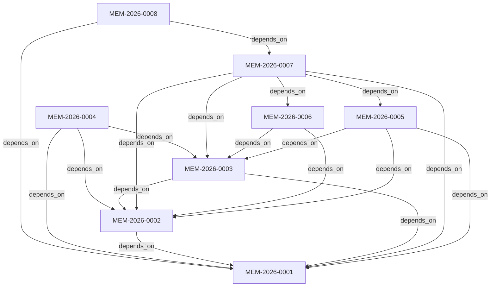

# 🗺️ PotoTypeV0 × Friday Context Registry & Topology Map (CONTEXT_MAP.md)

> **自動生成時間**: `2026-10-19T15:55:55Z` | **Agentic Harness**: `Friday` | **記憶節點總數**: `8`
> **漸進式揭露原則 (Progressive Disclosure)**: Agent 啟動時僅注入本索引之單行摘要，按節點鍵值 (`node_key`) 或節點 ID (`node_id`) 按需調閱對應檔案。

## 1. 領域分層索引表 (Domain Layer Registry 000–900)

### 🧩 `000` — 000 核心憲法與認知規範 (Core Constitution & Epistemic Rules)

| 定位鍵 (`node_key`) | 節點 ID (`node_id`) | 類型 | 狀態 | 產出模型 ➔ 審查模型 | 單行摘要 (`summary_1line`) | 路徑 |
| :--- | :--- | :---: | :---: | :--- | :--- | :--- |
| `000.SOUL.v1` | `MEM-2026-0001` | `constitution` | `verified` | `deepseek-ai/deepseek-v4.1-flash` ➔ `z-ai/glm-5.3` | Friday Agentic Harness 核心憲法：定義四級認知誠實標籤、跨模型對抗審查與獨立驗證斷言 (Oracle) 鐵律。 | [000_SOUL.md](000_SOUL.md) |

### 🧩 `100` — 100 安全邊界與工作區護欄 (Workspace Boundary & Security Guard)

| 定位鍵 (`node_key`) | 節點 ID (`node_id`) | 類型 | 狀態 | 產出模型 ➔ 審查模型 | 單行摘要 (`summary_1line`) | 路徑 |
| :--- | :--- | :---: | :---: | :--- | :--- | :--- |
| `100.ARCH-RULES.v1` | `MEM-2026-0002` | `rule` | `verified` | `deepseek-ai/deepseek-v4.1-flash` ➔ `z-ai/glm-5.3` | 定義 Friday Harness 之工作區邊界護欄：鎖定 ctx.cwd、保護 .Friday 大腦核心 (SEC-BRAIN)、隔離金鑰 (SEC-CRED) 與攔截危險指令。 | [100_ARCH_RULES.md](100_ARCH_RULES.md) |

### 🧩 `200` — 200 架構決策與跨模型審查 (Architecture Decisions & Cross-Review)

| 定位鍵 (`node_key`) | 節點 ID (`node_id`) | 類型 | 狀態 | 產出模型 ➔ 審查模型 | 單行摘要 (`summary_1line`) | 路徑 |
| :--- | :--- | :---: | :---: | :--- | :--- | :--- |
| `200.ADR-001.v1` | `MEM-2026-0003` | `adr` | `verified` | `deepseek-ai/deepseek-v4.1-flash` ➔ `z-ai/glm-5.3` | ADR-001：採用 Pi v1.3.0 registerVirtualModel 實作 pi-router/auto 動態路由，並配置 5 角色跨模型子代理協作團隊。 | [200_DECISIONS.md](200_DECISIONS.md) |
| `200.OPT-ROADMAP.v1` | `MEM-2026-0007` | `spec` | `verified` | `deepseek-ai/deepseek-v4.1-flash` ➔ `z-ai/glm-5.3` | PotoTypeV0 × Friday 六階段通用優化、固定主腦調度、防錯亂保險 (AS-05/AS-06/Drift Alert) 與 /dream 夢境記憶整理演進路線圖。 | [200_OPTIMIZATION_ROADMAP.md](../specs/200_OPTIMIZATION_ROADMAP.md) |

### 🧩 `300` — 300 核心領域邏輯與模組 (Core Domain Modules)

| 定位鍵 (`node_key`) | 節點 ID (`node_id`) | 類型 | 狀態 | 產出模型 ➔ 審查模型 | 單行摘要 (`summary_1line`) | 路徑 |
| :--- | :--- | :---: | :---: | :--- | :--- | :--- |
| `300.LEDGER.v1` | `MEM-2026-0008` | `spec` | `verified` | `nvidia/nemotron-3-super-120b-a12b` ➔ `deepseek-ai/deepseek-v4.1-flash` | 專案唯一活躍工單台帳 (LEDGER.md)：嚴格限制總行數 <= 80 行，僅追蹤進行中任務，完工項目即刻歸檔。 | [LEDGER.md](../LEDGER.md) |

### 🧩 `500` — 500 動態模型路由與子代理編排 (Model Routing & Subagents)

| 定位鍵 (`node_key`) | 節點 ID (`node_id`) | 類型 | 狀態 | 產出模型 ➔ 審查模型 | 單行摘要 (`summary_1line`) | 路徑 |
| :--- | :--- | :---: | :---: | :--- | :--- | :--- |
| `500.MODEL-APIKEY-SPEC.v1` | `MEM-2026-0006` | `spec` | `verified` | `deepseek-ai/deepseek-v4.1-flash` ➔ `z-ai/glm-5.3` | Friday 模型分配之 4 大設定位置（models.json、settings.json、model-router.ts、agents/*.md）與多組 API Key 分流配置規格。 | [500_MODEL_APIKEY_GUIDE.md](../specs/500_MODEL_APIKEY_GUIDE.md) |

### 🧩 `600` — 600 驗證斷言、測試與安全稽核 (Verification Oracles & Audits)

| 定位鍵 (`node_key`) | 節點 ID (`node_id`) | 類型 | 狀態 | 產出模型 ➔ 審查模型 | 單行摘要 (`summary_1line`) | 路徑 |
| :--- | :--- | :---: | :---: | :--- | :--- | :--- |
| `600.AUDIT-001.v1` | `MEM-2026-0004` | `audit` | `verified` | `poolside/laguna-xs-2.1` ➔ `z-ai/glm-5.3-flash` | PotoTypeV0 專案與 Friday Agentic Harness 初始化驗收紀錄：記錄四大核心模組之驗收基準與依賴拓撲。 | [MEM-2026-0004_HARNESS_INIT_AUDIT.md](../audits/MEM-2026-0004_HARNESS_INIT_AUDIT.md) |

### 🧩 `700` — 700 可攜式部署與容器封裝 (Portable Brain & Containerization)

| 定位鍵 (`node_key`) | 節點 ID (`node_id`) | 類型 | 狀態 | 產出模型 ➔ 審查模型 | 單行摘要 (`summary_1line`) | 路徑 |
| :--- | :--- | :---: | :---: | :--- | :--- | :--- |
| `700.HARNESS-BLUEPRINT.v1` | `MEM-2026-0005` | `spec` | `verified` | `deepseek-ai/deepseek-v4.1-flash` ➔ `z-ai/glm-5.3` | Friday × PotoTypeV0 雙層可攜式 Agentic Harness 完整架構藍圖、四大生命週期與全文件 Schema 防錯亂機制。 | [700_HARNESS_BLUEPRINT.md](../specs/700_HARNESS_BLUEPRINT.md) |

## 2. 記憶節點依賴拓撲圖 (Context Dependency DAG)

## 3. 專案治理目錄結構摘要

- `.Friday/` — 專案內嵌可攜式 Agentic Harness 大腦（含模型路由、安全護欄、漸進式揭露與 5 角色子代理）
- `schemas/` — 記憶節點標頭 (`artifact_header.schema.json`)、Context 拓撲節點 (`context_node.schema.json`) 與防諂媚驗證器 (`schema_validator.py`)
- `memory/codex/` — 核心架構規範 (`000_SOUL.md`, `100_ARCH_RULES.md`, `200_DECISIONS.md`) 與自動編譯總目錄 (`CONTEXT_MAP.md`)
- `memory/specs/` — 統一納管之系統架構藍圖 (`700_HARNESS_BLUEPRINT.md`)、模型與金鑰設定指南 (`500_MODEL_APIKEY_GUIDE.md`) 與六階段演進路線圖 (`200_OPTIMIZATION_ROADMAP.md`)
- `memory/audits/` — 跨模型交叉審查與架構驗證紀錄
- `memory/index/CONTEXT_INDEX.json` — 機器可讀之漸進式揭露 Context 索引
- `scripts/` — Context 索引編譯器 (`auto_update_map.py`) 與端到端架構驗收套件 (`test_friday_architecture.py`)
