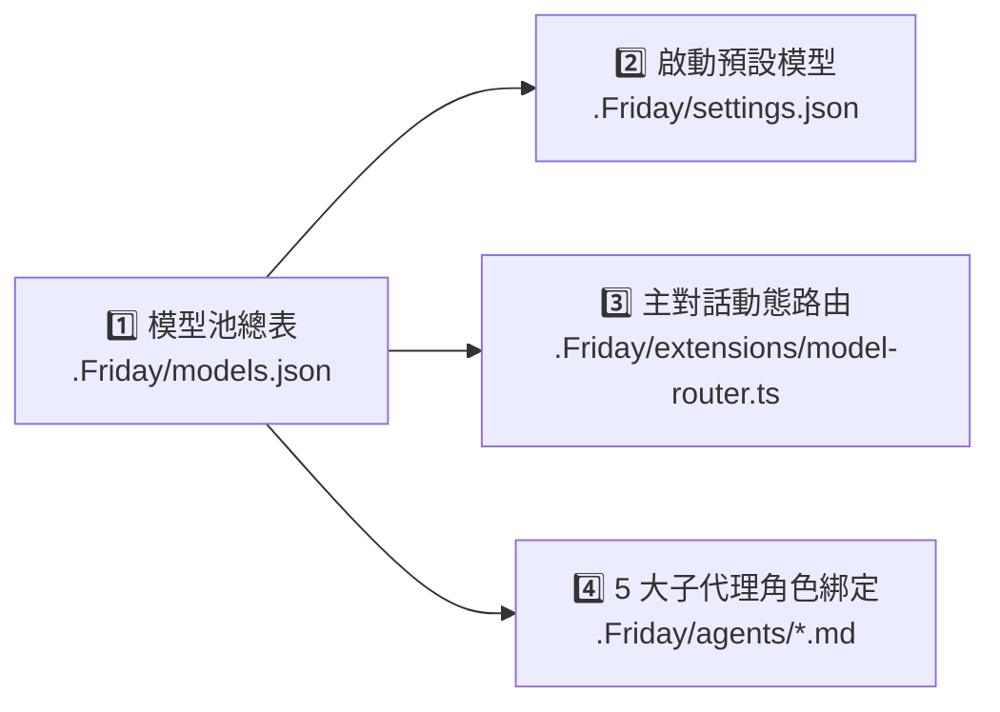

# ⚙️ `500.MODEL-APIKEY-SPEC.v1` (MEM-2026-0006) — 模型分配與多組 API Key 設定指南

本規格文件說明 **Friday 大腦 (`.Friday/`)** 中「模型分配」的 4 個設定位置，以及如何設定「**不同模型 / 不同子代理使用不同 API Key**」。

---

## 一、 模型分配的設定在哪裡？（4 大設定位置）



1. `[FACT]` **可用模型池總表（[`.Friday/models.json`](../../.Friday/models.json)）**：定義供應商 (`providers`) 與可用模型 (`models`) 清單，包含 API 端點 (`baseUrl`)、上下文視窗 (`contextWindow`)、最大輸出 (`maxTokens`) 與相容參數 (`compat`)。
2. `[FACT]` **大腦啟動預設模型（[`.Friday/settings.json`](../../.Friday/settings.json)）**：決定啟動 `pi` 時預設掛載的 `defaultProvider`（目前為 `"pi-router"`）與 `defaultModel`（目前為 `"auto"`），以及預設啟用的高速檢索工具（`+grep`, `+find`, `+ls`）。
3. `[FACT]` **主對話路由分配（[`.Friday/extensions/model-router.ts`](../../.Friday/extensions/model-router.ts)）**：定義 `ROLE_MODELS` 映射表，控制各個模式（`scout`、`architect`、`code`、`audit`、`vision`）對應的目標模型。
4. `[FACT]` **5 大子代理角色綁定（[`.Friday/agents/*.md`](../../.Friday/agents)）**：每個子代理檔案頂部的 YAML Frontmatter 透過 `model: <provider>/<model_id>` 指定專屬模型與工具權限：

| 子代理角色檔 | 目前綁定模型 (`model:`) | 允許使用的工具 (`tools:`) |
| :--- | :--- | :--- |
| [`.Friday/agents/scout.md`](../../.Friday/agents/scout.md) | `nvidia/nemotron-3.5-lightning-30b-a3b` *(Stage 1 將升級為 `glm-5.3-flash`)* | `read, grep, find, ls` (唯讀) |
| [`.Friday/agents/architect.md`](../../.Friday/agents/architect.md) | `nvidia/deepseek-ai/deepseek-v4.1-flash` *(Stage 1 將升級為 `nemotron-3-super-120b-a12b`)* | `read, grep, find, ls` (唯讀) |
| [`.Friday/agents/challenger.md`](../../.Friday/agents/challenger.md) | `nvidia/z-ai/glm-5.3` *(Stage 1 將升級為 `nemotron-3-nano-omni-30b-a3b-reasoning`)* | `read, grep, find, ls` (唯讀) |
| [`.Friday/agents/worker.md`](../../.Friday/agents/worker.md) | `nvidia/poolside/laguna-xs-2.1` | `read, edit, write, bash, grep, find, ls` |
| [`.Friday/agents/auditor.md`](../../.Friday/agents/auditor.md) | `nvidia/z-ai/glm-5.3-flash` | `read, bash, grep, find, ls` |

---

## 二、 不同模型 / 不同子代理使用不同 API Key 的 3 種配置方案

1. `[INFERRED]` 透過 `@earendil-works/pi-coding-agent` v1.3.0 的多供應商與模型 Header 覆寫機制，可依安全層級與分流需求選擇以下三種多 Key 配置方案：

### 方案 A（最推薦）：在 `auth.json` + `models.json` 拆分多個 Provider 別名（適合多把同平台 Key 分流 Rate Limit 額度）

#### 步驟 1：在 `.Friday/auth.json` 填入多把 Key（受 `SEC-CRED` 絕對保護）
```json
{
  "nvidia": {
    "type": "api_key",
    "key": "nvapi-你的第一把主力Key"
  },
  "nvidia-sub": {
    "type": "api_key",
    "key": "nvapi-你的第二把子代理專用Key"
  }
}
```

#### 步驟 2：在 [`.Friday/models.json`](../../.Friday/models.json) 新增對應的 Provider 區塊
```json
{
  "providers": {
    "nvidia": {
      "baseUrl": "https://integrate.api.nvidia.com/v1",
      "api": "openai-completions",
      "models": [ ... ]
    },
    "nvidia-sub": {
      "baseUrl": "https://integrate.api.nvidia.com/v1",
      "api": "openai-completions",
      "models": [
        {
          "id": "poolside/laguna-xs-2.1",
          "name": "Laguna XS 2.1 (Subagent Key)",
          "api": "openai-completions",
          "contextWindow": 256000,
          "maxTokens": 32768
        }
      ]
    }
  }
}
```

#### 步驟 3：在子代理（如 [`.Friday/agents/worker.md`](../../.Friday/agents/worker.md)）指定該 Provider
```yaml
---
name: worker
model: nvidia-sub/poolside/laguna-xs-2.1
---
```

---

### 方案 B：在 `models.json` 的「單一模型 (`models[]`)」內用 `headers` 覆寫金鑰

每一顆模型 (`models[]`) 皆支援獨立的 `"headers"` 屬性（優先權高於 Provider 預設值），支援環境變數插值 `"Bearer ${NVIDIA_GLM_API_KEY}"` 或動態指令 `"!cat ~/.secrets/glm_key_header"`：

```json
{
  "id": "z-ai/glm-5.3-flash",
  "name": "GLM 5.3 Flash",
  "api": "openai-completions",
  "provider": "nvidia",
  "baseUrl": "https://integrate.api.nvidia.com/v1",
  "headers": {
    "NVCF-POLL-SECONDS": "30",
    "Authorization": "Bearer ${NVIDIA_GLM_API_KEY}"
  }
}
```

---

### 方案 C：跨供應商混合分配（OpenAI + Anthropic + OpenRouter + NVIDIA 混搭）

在 `.Friday/auth.json`（或透過 `/login`）分別設定 `nvidia`、`anthropic`、`openai`、`openrouter` 金鑰後，直接於 `.Friday/agents/*.md` 指定對應 `<provider>/<model_id>` 即可跨廠牌混搭調度。

---

## 三、 `pi` 解析 API Key 的優先順序（由高至低）

| 優先序 | 來源位置 | 安全與治理說明 |
| :---: | :--- | :--- |
| **1** | CLI 啟動參數 `pi --api-key <key>` | 單次覆寫最高優先權 |
| **2** | `.Friday/auth.json` 中對應 Provider 的 `key` | **最推薦**：權限 `0600` 且受 `SEC-CRED` 封鎖保護 |
| **3** | [`.Friday/models.json`](../../.Friday/models.json) 的 `apiKey` 或 `headers.Authorization` | 建議搭配 `${ENV_VAR}` 環境變數插值使用 |
| **4** | 系統環境變數（如 `NVIDIA_API_KEY`、`OPENAI_API_KEY`） | 適合容器化或 CI/CD 環境注入 |
