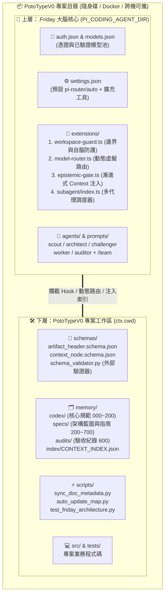

# 🏗️ `700.HARNESS-BLUEPRINT.v1` (MEM-2026-0005) — 雙層可攜式 Agentic Harness 完整架構藍圖

本規格文件完整定義如何在 `@earendil-works/pi-coding-agent`（底層物理馬具 Base Harness）之上，搭建 **Friday 可攜式高階治理馬具（Meta-Harness）**，包含所有建構元件清單、執行期四大生命週期，以及**全文件 Schema 納管與防 Agent 錯亂機制**。

---

## 一、 核心設計哲學：為什麼是「雙層可攜式 Harness」？

1. `[FACT]` 原生 `pi` CLI 刻意保持極簡（僅提供 `read`、`write`、`edit`、`bash` 四大基礎工具與 41 個 Extension 生命週期事件插槽，預設不設目錄鎖定、不設防諂媚機制、也不做跨模型動態路由）。
2. `[FACT]` 我們透過環境變數 **`PI_CODING_AGENT_DIR=$(pwd)/.Friday`**，將「大腦治理層（`.Friday/`）」內嵌於「專案工作區（`PotoTypeV0/`）」之中，形成 **雙層可攜式 Agentic Harness**：

---

## 二、 完整建置清單與功能對照表

### A. 大腦核心層：`.Friday/`（隨 `PI_CODING_AGENT_DIR` 啟動即無條件載入）

| 建構項目 (檔案路徑) | 類別 | 核心功能說明 |
| :--- | :---: | :--- |
| [`.Friday/auth.json`](../../.Friday/auth.json) | 憑證層 | 存放 NVIDIA NIM API Key（權限 `0600`），受 `workspace-guard.ts` 的 `SEC-CRED` 絕對保護，禁止任何工具或 Bash 讀取。 |
| [`.Friday/models.json`](../../.Friday/models.json) [`.Friday/models-store.json`](../../.Friday/models-store.json) | 模型池 | 定義經實測 100% 可用的 **12 款 NVIDIA 模型**（含 10 款免費 `cost=0` 模型），已剔除會發生 HTTP 404 或無限 Hang 的壞死模型。 |
| [`.Friday/settings.json`](../../.Friday/settings.json) | 啟動設定 | 設定大腦預設供應商為 `"pi-router"`、預設模型為 `"auto"`、預設思考層級 `"defaultThinkingLevel": "low"`，並預設開啟 `+grep`、`+find`、`+ls` 高速檢索工具。 |
| [`.Friday/AGENTS.md`](../../.Friday/AGENTS.md) | 大腦憲法 | 定義 Friday 的四大核心機制（漸進式 Context 揭露、認知誠實標籤、工作區安全邊界、跨模型協作）與專屬 Slash 指令清單。 |
| [`.Friday/extensions/workspace-guard.ts`](../../.Friday/extensions/workspace-guard.ts) | 安全護欄 Hook | 掛載 `tool_call` 與 `user_bash` 攔截器，提供四大防護： 1. **`BOUNDARY`**：鎖定讀寫於 `ctx.cwd`，越界時在 TUI 彈出 `ctx.ui.select` 授權視窗（子代理無頭模式直接封鎖）。 2. **`SEC-CRED`**：無條件封鎖 `auth.json`、`.env`、私鑰存取。 3. **`SEC-BRAIN`**：防止 Agent 自動修改 `.Friday/` 大腦自身設定與擴充碼。 4. **`SEC-CMD-V1`**：攔截 `rm -rf /`、`mkfs`、`curl\|sh` 等毀滅性指令。 提供 `/guard [reset\|validate]` 指令（含工作區授權重設與全庫 Schema 神諭驗證）。 |
| [`.Friday/extensions/model-router.ts`](../../.Friday/extensions/model-router.ts) | 固定主腦與派工 Hook | 註冊 **`pi-router/auto`（固定主腦以 `.Friday/role-models.json` 中的 `orchestrator` 為準，目前實際運行為 `nvidia/nemotron-3.5-super-vl-120b-a12b`）**，專家層不再使用已 404 下架之 `nvidia/nemotron-3-super-120b-a12b`，改用 `nvidia/nemotron-3-ultra-550b-a55b` / `z-ai/glm-5.3`；並註冊零冷啟動之 **`dispatch_specialist`**（In-Process 多輪累進迴圈、Token Offload Gate、非侵入式 Per-Loop Round-Robin + Sticky Key + 429 等待、尾端隱形 `[MANDATE]` 注入保護 Prefix KV Cache、多輪頂層 `usage` 累加）與 `/mode`、`/context`（四維度 Context 與快取鑑識儀表板）指令。 |
| [`.Friday/extensions/epistemic-gate.ts`](../../.Friday/extensions/epistemic-gate.ts) | Context 注入與同步 Hook | 掛載 `before_agent_start` 事件動態注入 **Session 級釘選 (`Session-Pinned`)** 之 `memory/index/CONTEXT_INDEX.json` 單行摘要（避免中途修改 `.md` 破壞 Token 0 Prefix KV Cache），並於 `tool_result` 攔截 `memory/**/*.md` 修改時自動執行 `sync_doc_metadata.py`、`schema_validator.py` 與 `auto_update_map.py`。 |
| [`.Friday/extensions/subagent/index.ts`](../../.Friday/extensions/subagent/index.ts) | 子代理調度器 | 註冊 `subagent` 工具，支援以獨立 `pi --mode json -p --no-session` 子行程執行 **單一 (`single`)**、**並行 (`parallel`)** 與 **流水線 (`chain`)** 跨模型子代理調度，並將所有子代理 Token 消耗自動匯總掛載至頂層 `AgentToolResult.usage` 供 `/session` 與 `/context` 精確統計。 |
| [`.Friday/agents/*.md`](../../.Friday/agents) | 5 角色定義 | 定義 5 個不同模型家族與工具權限的子代理： • [`scout.md`](../../.Friday/agents/scout.md)：高速唯讀檢索 • [`architect.md`](../../.Friday/agents/architect.md)：系統設計 • [`challenger.md`](../../.Friday/agents/challenger.md)：跨模型抗諂媚找碴審查 • [`worker.md`](../../.Friday/agents/worker.md)：程式碼實作與重構 • [`auditor.md`](../../.Friday/agents/auditor.md)：執行外部驗證腳本驗收 |
| [`.Friday/prompts/team.md`](../../.Friday/prompts/team.md) | 團隊指令模板 | 註冊 `/team <任務>` 快捷指令，一鍵觸發 `scout -> architect -> challenger -> worker -> auditor` 五階段對抗流水線。 |

### B. 專案治理層：`PotoTypeV0/`（工作區記憶拓撲與獨立外部驗證器）

| 建構項目 (檔案路徑) | 類別 | 核心功能說明 |
| :--- | :---: | :--- |
| [`AGENTS.md`](../../.Friday/AGENTS.md) | 專案規範 | 說明專案目錄結構，並規定唯有修改 `memory/` 下之架構記憶節點時才需執行驗證。 |
| [`schemas/artifact_header.schema.json`](../../schemas/artifact_header.schema.json) | 治理標頭契約 | 規範記憶節點的 `node_id`、`artifact_type`、`status`、`author`、`reviewer`、`epistemic_profile` 與 `verification_oracle`。 |
| [`schemas/context_node.schema.json`](../../schemas/context_node.schema.json) | 拓撲索引契約 | 規範 `context_index`（領域分層碼 `000`–`900`、定位鍵 `node_key`、單行摘要 `summary_1line`）與 `topology`（`depends_on`、`affected_paths`）。 |
| [`schemas/schema_validator.py`](../../schemas/schema_validator.py) | 外部驗證神諭 (Oracle) | 獨立於 LLM 之外的 Python 驗證程式，強制執行防諂媚與拓撲完整性檢查（`AS-01` ~ `AS-06`）。 |
| [`scripts/sync_doc_metadata.py`](../../scripts/sync_doc_metadata.py) | 雙階段 `.md` 同步器 | Two-Phase Commit 確定性同步腳本：原地重算 `epistemic_profile` 四級標籤、同步 SSOT 模型表，並於新檔合規時自動將 `supersedes` 舊節點降級為 `deprecated`。 |
| [`scripts/auto_update_map.py`](../../scripts/auto_update_map.py) | Context 索引編譯器 | 自動掃描 `memory/` 下所有節點，編譯出機器可讀的 [`memory/index/CONTEXT_INDEX.json`](../index/CONTEXT_INDEX.json) 與視覺化拓撲圖 [`memory/codex/CONTEXT_MAP.md`](../codex/CONTEXT_MAP.md)。 |
| [`memory/codex/*.md`](../codex) [`memory/specs/*.md`](.) [`memory/audits/*.md`](../audits) | 結構化記憶庫 | 100% 納入 Schema 管轄之單一真相庫：包含核心憲法與規則 (`codex/`)、架構藍圖與操作規格 (`specs/`) 以及驗收報告 (`audits/`)。 |
| [`scripts/test_friday_architecture.py`](../../scripts/test_friday_architecture.py) | 端到端驗收套件 | 自動化執行 12 大整合測試（`TEST 1 ~ TEST 12`），驗證 Schema、防諂媚陷阱、工作區越界攔截、多輪路由、Sticky Key 池、Hook `.md` 自動同步、Prefix KV Cache 防護與 `/context` 儀表板。 |

---

## 三、 整體運作邏輯（四大執行期生命週期）

### 1. 啟動期 (Bootstrap Lifecycle)
1. `[FACT]` 當在專案根目錄執行 `PI_CODING_AGENT_DIR=$(pwd)/.Friday pi` 時，`pi` 會載入 `.Friday/auth.json`、`.Friday/models.json` 與 `.Friday/extensions/` 下的 4 個擴充套件，並在底部狀態列顯示 `🛡️ Lock:PotoTypeV0` 與 `🧠 [AUTO] pi-router/auto`。

### 2. 對話與漸進式揭露期 (Turn Start & Progressive Disclosure)
1. `[FACT]` [`epistemic-gate.ts`](../../.Friday/extensions/epistemic-gate.ts) 不會把 `memory/` 下所有 Markdown 全文塞進 System Prompt，而是只注入 [`CONTEXT_INDEX.json`](../index/CONTEXT_INDEX.json) 中每個有效節點的 **一行摘要 (`summary_1line`) 與檔案相對路徑**，讓 Agent 按需調閱。

### 3. 工具呼叫與安全邊界攔截期 (Tool Execution & Boundary Guard)
1. `[FACT]` 每當 LLM 呼叫任何工具時，都會先經過 [`workspace-guard.ts`](../../.Friday/extensions/workspace-guard.ts) 的防護閘門（`SEC-CMD-V1` 危險指令攔截、`SEC-CRED` 憑證保護、`SEC-BRAIN` 大腦防竄改、`SEC-PORTABILITY` 絕對路徑防洩漏、`BOUNDARY` 工作區鎖定）。

### 4. 跨模型對抗協作與外部驗證期 (Multi-Agent Dialectical Pipeline)
1. `[INFERRED]` 透過將不同模型家族綁定於 `scout`、`architect`、`challenger`、`worker`、`auditor` 並搭配外部 Python Oracle ([`schema_validator.py`](../../schemas/schema_validator.py))，可從物理架構上消除單一模型自寫自誇之諂媚偏誤。

---

## 四、 全文件 Schema 納管與防 Agent 錯亂機制 (Zero-Drift Context Governance)

為了防止文件散落於 Schema 管轄之外（形成 Agent 讀不到或新舊衝突的「幽靈文件」），本架構實施 **全文件統一納管** 與 **三大防錯亂保險**：

1. `[INFERRED]` **消除法外之地與三大防錯亂保險（Zero-Drift Safeguards）**：
   - **統一納管至 `memory/`**：所有核心規則 (`memory/codex/`)、架構藍圖與指南 (`memory/specs/`)、驗收報告 (`memory/audits/`) 均強制掛載 Schema 標頭。人類僅需查閱單一總表 [`memory/codex/CONTEXT_MAP.md`](../codex/CONTEXT_MAP.md)，Agent 則透過 `CONTEXT_INDEX.json` 自動獲知所有文件位置，無須記憶目錄結構。
   - **保險 A — 依 `artifact_type` 分級之散文行數預算（Stage 4）**：`constitution` / `rule` / `adr` 限制純散文 $\le 50$ 行以維持極簡高密度；`spec` / `audit` 放寬純散文至 $\le 160$ 行（且表格、Mermaid 圖表、程式碼區塊完全豁免行數計算），兼顧完整藍圖可讀性與 Schema 紀律。
   - **保險 B — `AS-06` 新舊版本互斥與過時節點自動隔離（Stage 4 & Stage 5）**：當新節點宣告 `supersedes` 取代舊節點時，舊節點必須降級為 `archived` 或 `deprecated`；且 `epistemic-gate.ts` 於每回合注入索引時**自動過濾 `archived` / `deprecated` 節點**，保證 Agent 絕不載入過時資訊。
   - **保險 C — `affected_paths` 源碼變更連動警報（Code-to-Spec Drift Alert，Stage 5）**：每份 `spec` 藍圖皆於 `topology.affected_paths` 綁定其所描述之真實程式碼。當 Agent 修改對應源碼時，Hook 自動發出連動提醒，確保「源碼改到哪、藍圖同步更新到哪」。

---

## 五、 常用操作速查表

| 操作目的 | 指令 / 方式 |
| :--- | :--- |
| **啟動 PotoTypeV0 專屬 Friday 大腦** | `PI_CODING_AGENT_DIR=$(pwd)/.Friday pi` |
| **熱重載大腦設定與擴充套件** | `/reload` |
| **檢視或切換動態模型路由** | `/mode` 或 `/mode [auto\|scout\|architect\|code\|audit\|vision]` |
| **檢視 Context 結構、快取命中率與省流成效** | `/context`（支援 `/context [turns\|tools\|json\|pin-refresh]`） |
| **檢視或重設工作區邊界授權 / 全庫驗證** | `/guard`、`/guard reset` 或 `/guard validate`（手動執行 `schema_validator.py --run-oracle` 與索引重編） |
| **啟動 5 角色跨模型對抗流水線** | `/team <你的任務描述>` |
| **執行全架構 12 合 1 自動化驗收** | `python3 scripts/test_friday_architecture.py` |
